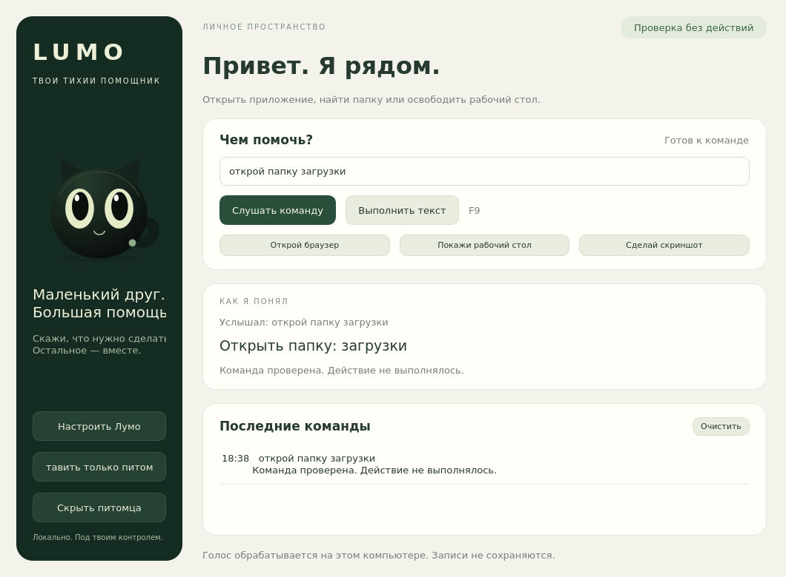

# Лумо / Lumo

**Маленький друг. Большая помощь.**

Лумо — настольный голосовой помощник с собственным интерфейсом и питомцем на
рабочем столе. Дипломный проект: «Разработка настольного голосового помощника
„Лумо“ с нейросетевой интерпретацией команд и анимированным персонажем».



## Что работает

- **Собственное приложение на Qt Widgets**: без браузера и web-оболочки.
- **Питомец**: прозрачное окно, анимация глаз и дыхания, состояния ожидания,
  записи, обработки, результата и подтверждения. Перетаскивание, закрепление,
  размер, сохранение положения, настройка «поверх окон» и контекстное меню.
  Режим «Оставить только питомца» скрывает основное окно; двойной щелчок возвращает его.
- **Команды текстом и голосом**: выбор микрофона, завершение по паузе, остановка
  записи кнопкой, фоновое распознавание Faster-Whisper и горячая клавиша.
- **Настройки приложений и папок**: редактирование разрешённых объектов и алиасов,
  выбор пути через диалог. Настройки сохраняются между запусками.
- **Понимание команды**: правила, необязательная обученная модель восстановления
  и необязательная локальная языковая модель через Ollama.
- **Контроль выполнения**: безопасный режим, явное подтверждение опасных действий
  и всех нейросетевых предложений, отмена, срок действия и одноразовое подтверждение.
- **Локальная история** последних 100 результатов с возможностью очистки.
  Временная аудиозапись удаляется после распознавания, включая путь ошибки.

Это рабочая версия **0.2**, а не завершённая аттестация качества. Интерфейс и
логика проверяются автоматически; реальные действия ОС и микрофон необходимо
дополнительно проверить на целевой Windows-машине. Поддержка выполнения команд
в Linux запланирована отдельно: сейчас на Linux доступны интерфейс, питомец,
распознавание и dry-run. Закрепление и положение виджета зависят от оконного
менеджера; в Wayland требуется отдельная проверка.

## Быстрый запуск на Windows

Для воспроизводимой установки рекомендуется Python 3.12 или 3.13.

```powershell
python -m venv .venv
.\.venv\Scripts\Activate.ps1
python -m pip install --upgrade pip
pip install -c requirements-desktop.lock ".[voice]"
lumo
```

Для интерфейса, питомца и текстовых команд достаточно `pip install .`.
Голосовой компонент устанавливается через `[voice]`. Обучение моделей —
отдельный необязательный компонент `[ml]`.

При первом запуске:

1. Открой **Настроить Лумо → Модели**. Разреши загрузку Whisper для первой
   записи, если у тебя ещё нет локальной модели. Для слабого компьютера можно
   выбрать `base` или `tiny`; качество обязательно проверять на своих командах.
2. Проверь микрофон и пути приложений/папок. Указанный по умолчанию Chrome
   может отсутствовать; выбери свой браузер через диалог.
3. Начни в режиме **Проверка без действий**. Например, введи «запусти блокнот».
4. Когда пути проверены, отключи проверочный режим в настройках. В Windows F9
   работает глобально при доступности компонента горячих клавиш.

Распознавание локальное; скачивание модели требует интернета только при её
подготовке. Языковая модель не загружается приложением автоматически.

## Локальная нейросеть для свободных формулировок

Поддерживается локальный [Ollama](https://ollama.com/download). Например:

```text
ollama pull qwen3:1.7b
ollama serve
```

Если Ollama уже запущен как приложение или служба, второй запуск сервера не
нужен. В **Настроить Лумо → Модели** включи локальное понимание и укажи имя
загруженной модели. Запросы направляются только на `127.0.0.1:11434`, без
прокси и удалённых перенаправлений.

Модель возвращает структурированное предложение: намерение и объект из
разрешённого каталога. Она не получает возможности запускать произвольный код.
Лумо показывает интерпретацию и требует подтверждения **каждого** предложения
нейросети. Самооценка уверенности языковой модели не используется для разрешения
действий. При недоступности модели приложение показывает ошибку.

Есть также экспериментальная MLP-модель восстановления ASR-текста. Её веса
не входят в репозиторий; при отсутствии весов приложение работает без неё.
Audio CNN пока предназначена для эксперимента и не подключена к выполнению.

## Команды и диагностика

```powershell
lumo doctor
lumo command "открой папку загрузки" --dry-run
lumo listen --dry-run --duration 5
lumo transcribe path\to\recording.mp3
lumo devices
lumo gui --dry-run
```

`--execute` явно включает выполнение для одного CLI-запуска. Для опасного
действия CLI просит ввести `ДА` **после** определения команды. Подтвердить
заранее через флаг нельзя. При запуске без интерактивного ввода опасное действие
не выполняется. Команда `voice-pc` сохранена для совместимости.

Поддерживаются открытие разрешённых приложений/папок, скриншот, закрытие
активного окна, показ рабочего стола, диспетчер задач, настройки Windows,
терминал, блокировка, выключение и перезагрузка компьютера. Отрицания,
неполные и составные запросы консервативно отклоняются.

## Где находятся настройки

- Windows: `%LOCALAPPDATA%\Lumo`.
- Linux: `$XDG_DATA_HOME/lumo` или `~/.local/share/lumo`.
- Для изолированного профиля: переменная `LUMO_HOME`.
- `--project-root PATH` задаёт отдельный корень; при наличии `configs/`
  используются его конфигурации. Это удобно для разработки и экспериментов.

В профиле находятся `settings.yaml`, `apps.yaml`, `history.jsonl`, модели и
журналы CLI. Необходимые штатные конфигурации встроены в Python-пакет: запуск
не зависит от текущей папки. История содержит тексты команд; её можно очистить
кнопкой в приложении. Логи ограничены по размеру.

## Проверка и сборка

```powershell
pip install -c requirements-desktop.lock ".[dev]" build
pytest -q
ruff check src tests
python scripts/validate_voice_command_dataset.py --expected-count 86
python -m build --wheel
```

CI проверяет Windows/Linux и Python 3.12/3.13. Windows-сборка находится в
артефакте **Lumo-Windows** соответствующего запуска GitHub Actions. Архив
содержит папку `Lumo`; запускать нужно `Lumo.exe`, сохраняя `_internal` рядом.
Модели скачиваются отдельно. Сборка не включает Torch: MLP-восстановление
доступно при установке из Python с `[ml]`, Ollama работает как отдельный сервер.

Для локальной сборки Windows:

```powershell
pip install -c requirements-desktop.lock ".[voice,bundle]"
python -m PyInstaller --noconfirm lumo.spec
```

## Данные и эксперимент

В `data/dataset_curated` находятся 86 аудиозаписей с разметкой. Разбиение по
намерению фиксировано с seed=42: **64 train / 11 val / 11 test**. Единственный
скриншот оставлен в train; независимая оценка этого класса невозможна.
Корпус синтезированный, малый и не независимый по голосам. Он не заменяет
испытания с реальными людьми и микрофонами.

```powershell
python scripts/evaluate_pipeline.py --split test
python scripts/evaluate_pipeline.py --asr --model tiny --allow-download
```

Оценка выполняется в dry-run. Отчёт показывает точность intent и задержки,
не доказывая правильность действий Windows или извлечения всех объектов.
Подробности: [отчёт проверки](docs/VALIDATION.md), [план](docs/ROADMAP.md),
[архитектура](docs/ARCHITECTURE.md).

Исходная история проекта сохранена из [M_O](https://github.com/erlanbahtiyarov/M_O).
