# Архитектура Лумо

```mermaid
flowchart LR
  Input[Текст или микрофон] --> Worker[Фоновая задача]
  Worker --> ASR[Локальный Faster-Whisper]
  ASR --> Guard[Проверка входной фразы]
  Worker --> Guard
  Guard --> Rules[Правила и каталог объектов]
  Rules -->|Не распознано| Recovery[MLP или локальный Ollama]
  Recovery --> Validate[Проверка структуры и allowlist]
  Rules --> Execute[Исполнитель Windows]
  Validate --> Confirm[Одноразовое подтверждение с TTL]
  Confirm --> Execute
  Execute --> UI[Результат, история и состояние питомца]
```

Интерфейс использует Qt Widgets. Главное окно и DesktopPet — настоящие окна
ОС; персонаж отрисовывается QPainter, анимируется QTimer. Веб-компонентов нет.

Тяжёлая работа выполняется в Task/QThread. Сигналы доставляют результат в
главный поток. Модель Whisper повторно используется между записями. Временная
папка для аудио уничтожается в том числе при ошибке. Запись имеет предел по
времени, событие остановки и порог тишины.

VoiceControlService проверяет текст до обращения к нейросетям. Разрешённые
объекты берутся из AppsCatalog, действия — из CommandCatalog. Неизвестные
объекты не превращаются в произвольные пути или команды оболочки.

Подтверждение хранит копию интерпретации, режим выполнения, случайный токен и
монотонное время. Новый запрос, отмена, истечение срока, повторное использование
или изменение режима делают подтверждение недействительным. Выключение и
перезагрузка требуют подтверждения даже при ошибке конфигурационного флага.
Нейросетевое восстановление также требует подтверждения.

Локальная языковая модель подключается к loopback API Ollama со структурированной
JSON-схемой. Ответ валидируется повторно на стороне приложения. Самооценка уверенности языковой модели не используется: её нельзя считать
калиброванной вероятностью. Все предложения требуют подтверждения. Неоднозначность должна приводить к отказу.

Конфигурации по умолчанию упакованы в ресурсы. Пользовательские настройки
проверяются Pydantic и сохраняются через временный файл с заменой. Исходные
YAML в configs и пакетные копии синхронность проверяют тестом.

Исполнитель пока поддерживает реальную работу только в Windows. В Linux
возвращается unsupported_platform; правила, GUI, ASR и dry-run общие. Портирование
действий и проверка позиционирования виджета в Wayland остаются отдельным этапом.
