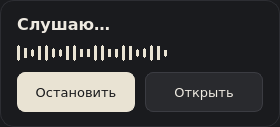
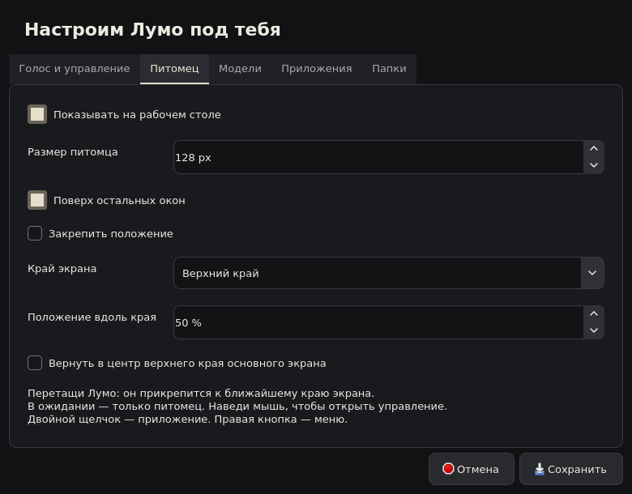

# Дизайн Лумо

Направление выбрано по запросу автора диплома: компактный виджет у края экрана,
как у [Nusa](https://rama2555.github.io/nusa/), и спокойное оформление компаньона,
как у [Coucou](https://louis-cfm.github.io/coucou/). Интерфейс реализован средствами
Qt Widgets и QPainter. Веб-оболочки нет.

Персонаж — чёрный шарик, слегка приплюснутый снизу, с двумя одинаковыми светлыми
кольцами глаз. Он смотрит прямо. Зелёной окантовки, ушей, хвоста и рта нет.
Питомец и иконка приложения нарисованы векторно; масштабирование не зависит от PNG.

## Поведение виджета

- В ожидании видны только питомец и компактная прямоугольная рамка с небольшим
  радиусом углов. Текст, имя и кнопки отсутствуют.
- После наведения на 250 мс рядом открывается панель управления. Уход мыши
  закрывает её через 350 мс; задержка позволяет перейти с питомца на панель.
- Во время записи или обработки панель показывает состояние и анимированный
  индикатор активности. Индикатор не является измерителем громкости микрофона.
- Кнопка «Остановить» завершает текущую запись. «Открыть» возвращает окно Лумо.
- Если нужно подтверждение, кнопка «Подтвердить…» открывает основное окно для
  проверки действия. Нажатие на питомца само по себе команду не подтверждает.
- В покое нет постоянного перерисовывания: работают только редкие моргания.
  Скрытые виджеты останавливают анимационные таймеры.

## Положение

Перетащи питомца в нужное место. При отпускании он прикрепится к ближайшему
краю рабочей области выбранного монитора. Вдоль края можно выбрать любую точку,
а не только центр или угол. Рабочая область учитывает панель задач.
Персонаж всегда остаётся вертикальным и смотрит на пользователя.

Сохраняются сторона, доля доступной длины края и имя монитора. Изменение размера
виджета или разрешения сохраняет относительное положение. Если монитор исчез,
виджет переносится в рабочую область основного экрана. Старые координаты
свободного виджета при первом запуске преобразуются в ближайшее крепление.

Правая кнопка открывает меню с выбором стороны и блокировкой перемещения.
В «Настроить Лумо → Питомец» доступны сторона, положение в процентах, размер
и возврат в центр верхнего края основного экрана. Двойной щелчок открывает приложение.

Панель раскрывается внутрь рабочей области и ограничивается её границами.
Реальное позиционирование и флаг «поверх окон» зависят от оконного менеджера;
на Windows и целевом Linux/Wayland их нужно проверить вручную.
