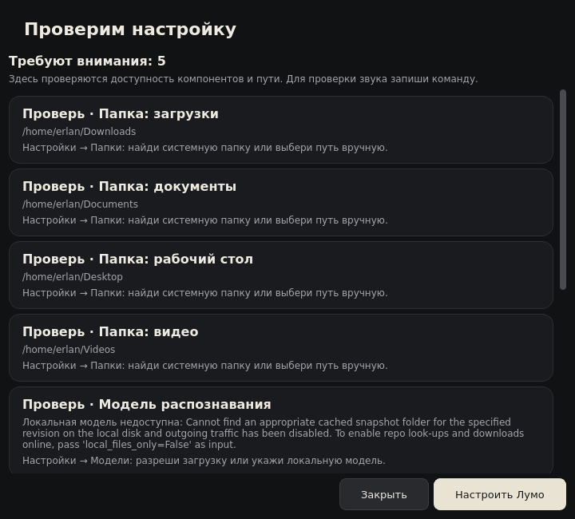
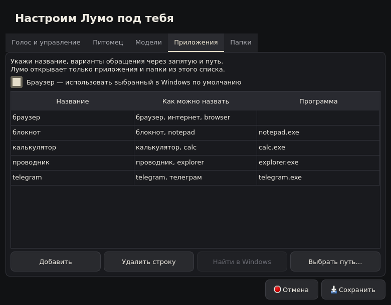

# Первый запуск и проверка готовности

В главном окне нажми **Проверить настройку**. Лумо проверит пути, компоненты
голосового ввода, файлы выбранной Whisper-модели, доступные устройства ввода
и выбранную модель в локальном Ollama, если его использование включено.
Проверка идёт в фоне; проблемы и подсказки показываются первыми.

Проверка не записывает звук и не запускает приложения, не устанавливает зависимости
и не скачивает модели. Она подтверждает наличие файлов, а не их целостность или
точность распознавания. Доступность микрофона в списке не заменяет пробную запись.
Для Ollama читается список моделей с `127.0.0.1:11434`, текст команд не отправляется.

## Браузер

В новом профиле включён выбор системного браузера Windows. Путь определяется
через ассоциацию протокола HTTPS, а не предполагаемую установку Chrome.
При новом запуске Лумо учитывает изменение браузера в настройках Windows.
Если Windows не сообщает путь к исполняемому файлу, Лумо предлагает ручной выбор,
а не запускает другой браузер наугад.

В **Настроить Лумо → Приложения** можно снять галочку системного браузера и
указать собственный файл. Аргументы прежнего ручного браузера не переносятся
на системный браузер. Брендовые имена Chrome и Firefox не являются синонимами
произвольного системного браузера: при необходимости добавь отдельные строки
приложений с нужными алиасами и путями.

## Приложения и папки

Новый профиль получает найденные пути стандартных приложений и системных папок.
Папки запрашиваются через Windows Known Folders, поэтому могут находиться на другом
диске или в OneDrive. Ничего не создаётся и не перемещается.
Сохранённые ручные пути и каталоги разработки из `--project-root` не заменяются.

Для существующего профиля выбери строку и нажми **Найти в Windows**. Кнопка меняет
только выбранную строку внутри диалога. **Отмена** отбрасывает изменения;
**Сохранить** применяет их. При отсутствии результата можно указать путь вручную.

Программы ищутся в пользовательском и системном App Paths, затем в абсолютных
каталогах PATH; для Telegram предусмотрена стандартная папка профиля.
Поддерживается поиск стандартных имён, а также имени `.exe` из текущего пути строки.
Это не полная инвентаризация Microsoft Store, ярлыков и всех программ на диске.
Поиск путей в Linux пока отключён: перенос действий Linux остаётся последним этапом.

## CLI

`lumo doctor` выводит JSON с общими сведениями и массивом `checks`.
`lumo doctor --microphone --ollama` дополнительно запрашивает список устройств
и локальный сервис. Проверочный отчёт сам не меняет настройки.
Текстовые команды остаются доступны при отсутствии голосового компонента.

После настройки проверь текстовую команду в режиме без действий, затем
запись настоящим микрофоном. Реальное открытие приложений, папок, горячую клавишу
и питомца необходимо испытать на целевом Windows-компьютере.

Реализация опирается на документацию Microsoft:
[SHGetKnownFolderPath](https://learn.microsoft.com/en-us/windows/win32/api/shlobj_core/nf-shlobj_core-shgetknownfolderpath),
[ассоциации протоколов](https://learn.microsoft.com/en-us/windows/win32/api/shlwapi/nf-shlwapi-assocquerystringw),
[регистрация App Paths](https://learn.microsoft.com/en-us/windows/win32/shell/app-registration).
